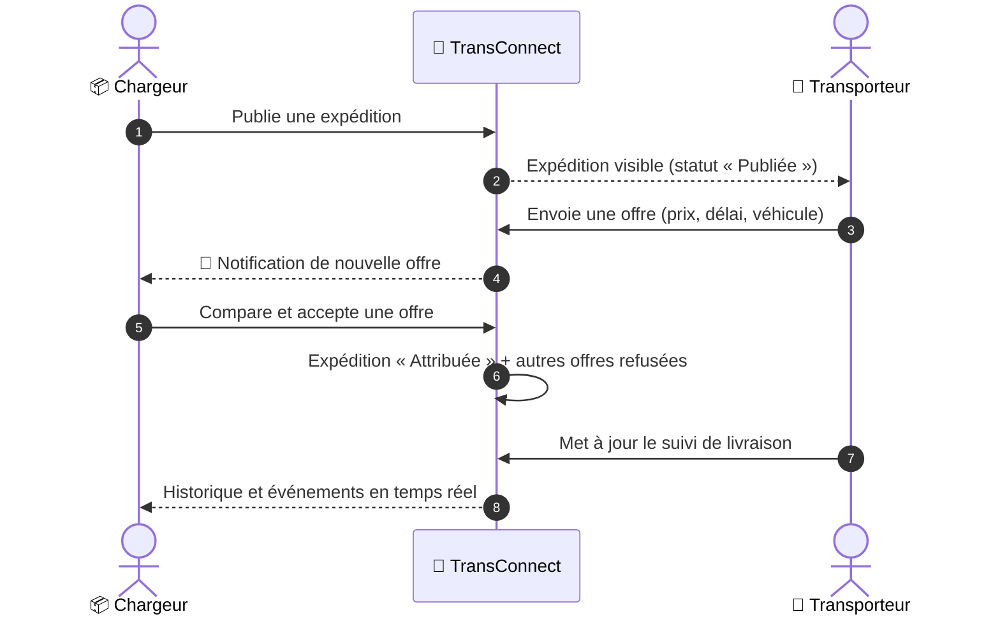
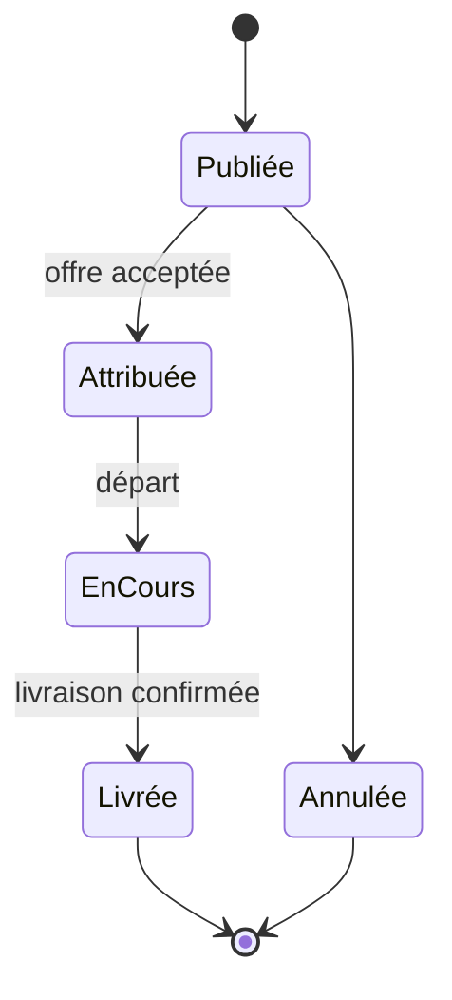

<div align="center">

# 🚛 TransConnect

### La plateforme B2B qui connecte **chargeurs** et **transporteurs**

*Publiez une expédition → recevez des offres → choisissez le meilleur transporteur → suivez la livraison.*

*Tout depuis un seul espace sécurisé.*

<br>


<br>


</div>

---

## 📖 Sommaire

- [Pourquoi TransConnect ?](#-pourquoi-transconnect-)
- [Aperçu](#-aperçu)
- [Fonctionnalités](#-fonctionnalités)
- [Comment ça marche](#-comment-ça-marche)
- [Rôles et droits](#-rôles-et-droits)
- [Règles métier](#-règles-métier)
- [Points forts techniques](#-points-forts-techniques)
- [Stack technique](#-stack-technique)
- [Démarrage rapide](#-démarrage-rapide)
- [Structure du projet](#-structure-du-projet)
- [Tests](#-tests)
- [Sécurité et production](#-sécurité-et-production)
- [Feuille de route](#-feuille-de-route)
- [Auteure](#-auteure)

---

## 💡 Pourquoi TransConnect ?

Dans le transport de marchandises, la mise en relation entre une entreprise qui doit expédier et un transporteur disponible reste souvent **manuelle** : appels, messages, devis dispersés, aucun historique.

**TransConnect centralise tout, de la publication au suivi de livraison.**

| 📦 Pour le **chargeur** | 🚚 Pour le **transporteur** |
| --- | --- |
| Publie ses besoins d'expédition | Consulte les expéditions disponibles |
| Compare les offres reçues | Propose prix, délai et véhicule |
| Accepte l'offre qui lui convient | Gère sa flotte et sa disponibilité |
| Suit la livraison étape par étape | Reçoit l'attribution automatiquement |

---

## 🖼️ Aperçu

| Tableau de bord | Détail d'une expédition | Mode sombre |
| :---: | :---: | :---: |
|  |  |  |

---

## ✨ Fonctionnalités

### 🔐 Comptes et authentification
- Inscription, connexion, déconnexion
- Modèle utilisateur personnalisé (`EntreprisesApp.Utilisateur`)
- Profil modifiable et changement de mot de passe
- Tableau de bord **adapté au rôle**
- Une seule entreprise par utilisateur

### 🏢 Entreprises
- Création, modification, consultation et suppression
- Type d'entreprise : `chargeur` ou `transporteur`
- Validation du **matricule fiscal tunisien**

### 📦 Expéditions
- Référence annuelle automatique : `EXP-AA-00001`
- Villes de départ et d'arrivée, date souhaitée, poids, description
- Statuts : *Publiée → Attribuée → En cours → Livrée* (ou *Annulée*)
- **Historique horodaté** de chaque changement de statut
- **Suivi de livraison** avec événements (type, description, auteur, date)
- Recherche par ville, statut et plage de poids
- **Isolation des données** : chaque chargeur ne voit que ses expéditions

### 🚚 Véhicules
- Immatriculation unique
- Types : camionnette, fourgon, camion porteur, semi-remorque
- Capacité contrôlée automatiquement selon le type
- Gestion de la disponibilité

### 💬 Offres
- Prix, délai et véhicule proposés par le transporteur
- Une seule offre active par transporteur et par expédition
- À l'acceptation : l'expédition devient *attribuée* et les autres offres sont automatiquement *refusées*
- 🔔 Notification au chargeur à chaque nouvelle offre

### 🎨 Interface
- Design B2B responsive, **mode clair / sombre** mémorisé
- Navigation mobile adaptée
- Illustrations et icônes SVG intégrées, **sans dépendance externe**
- Pagination, confirmations de suppression, affichage du mot de passe

---

## 🔄 Comment ça marche



### Cycle de vie d'une expédition



---

## 👥 Rôles et droits

| Fonction | Chargeur | Transporteur | Admin |
| --- | :---: | :---: | :---: |
| Tableau de bord et profil | ✅ | ✅ | ✅ |
| Gérer son entreprise | ✅ | ✅ | ✅ |
| Créer / modifier des expéditions | ✅ | ❌ | ✅ |
| Consulter les expéditions | ✅ | ✅ | ✅ |
| Gérer des véhicules | ❌ | ✅ | ✅ |
| Créer une offre | ❌ | ✅ | ✅ |
| Consulter les offres reçues | ✅ | ✅ | ✅ |
| Voir toutes les données | ❌ | ❌ | ✅ |

Les contrôles d'accès sont centralisés dans [`config/access.py`](config/access.py). Les vues filtrent aussi les querysets et formulaires pour empêcher l'accès aux objets d'une autre entreprise.

---

## 📐 Règles métier

### Compatibilité poids / véhicule

Limites centralisées dans [`config/weights.py`](config/weights.py) et comparées avec `Decimal` (pas d'erreurs de précision flottante) :

| Type de véhicule | Poids autorisé |
| --- | --- |
| 🚐 Camionnette | jusqu'à **1 500 kg** |
| 🚚 Fourgon | jusqu'à **3 500 kg** |
| 🚛 Camion porteur | de 3 500 à **19 000 kg** |
| 🚛 Semi-remorque | de 19 000 à **26 000 kg** |

### Validations
- Poids et prix strictement supérieurs à `0`
- Délai d'une offre : au moins **1 jour**
- Adresse d'entreprise : au moins **20 caractères**
- Une offre n'est possible que sur une expédition **publiée**
- Le véhicule doit appartenir au transporteur et être **disponible**

---

## 🏆 Points forts techniques

| | |
| --- | --- |
| 🧩 **Architecture modulaire** | 5 apps Django indépendantes, chacune avec une responsabilité claire |
| 🔒 **Sécurité par conception** | Contrôles d'accès centralisés + querysets filtrés par entreprise |
| 🧮 **Calculs fiables** | Comparaisons de poids avec `Decimal`, jamais de `float` |
| 🧾 **Traçabilité** | Historique horodaté des statuts et événements de suivi avec auteur |
| 🇹🇳 **Adapté au contexte local** | Validation du matricule fiscal tunisien, interface en français |
| 🪶 **Léger et autonome** | JavaScript natif, SVG inline, aucune dépendance front externe |
| 🌗 **UX soignée** | Mode clair / sombre mémorisé, responsive, navigation mobile |

---

## 🛠️ Stack technique

| Couche | Technologie |
| --- | --- |
| Backend | Python 3, **Django 5.2** |
| Base de données | SQLite (PostgreSQL recommandé en production) |
| Frontend | HTML5, CSS3, JavaScript natif, templates Django |
| Graphismes | SVG inline |
| Outillage | `uv` / `pip`, `python-dotenv` |

---

## 🚀 Démarrage rapide

### 1. Cloner le dépôt

```bash
git clone https://github.com/marnissi-nour/transconnect.git
cd transconnect
```

### 2. Installer les dépendances

**Avec [uv](https://docs.astral.sh/uv/) (recommandé)**

```bash
uv sync
```

**Ou avec pip**

```bash
python -m venv .venv
# Windows PowerShell : .\.venv\Scripts\Activate.ps1
# macOS / Linux     : source .venv/bin/activate
pip install "Django==5.2.*" "python-dotenv>=1.2.3"
```

### 3. Préparer la base de données

```bash
python manage.py migrate
python manage.py createsuperuser   # optionnel : accès à /admin/
```

### 4. Lancer le serveur

```bash
python manage.py runserver
```

👉 Ouvrez **http://127.0.0.1:8000/**

### 5. Essayer le parcours complet

1. 📦 Inscrivez-vous comme **chargeur** (`/inscription/`) et créez votre entreprise.
2. 🚚 Dans un autre navigateur, inscrivez-vous comme **transporteur**, créez l'entreprise et ajoutez un véhicule.
3. 📝 Le chargeur publie une expédition.
4. 💬 Le transporteur envoie une offre.
5. ✅ Le chargeur accepte l'offre et suit la livraison.

---

## 🗂️ Structure du projet

```text
transconnect/
├── config/                # Réglages, URLs, accès, poids, authentification
│   ├── access.py          # Rôles et règles d'accès
│   ├── weights.py         # Limites de poids partagées
│   └── settings.py
├── EntreprisesApp/        # Utilisateurs et entreprises
├── VehiculesApp/          # Flotte et capacités
├── ExpeditionsApp/        # Expéditions, historique, suivi
├── OffersApp/             # Offres et acceptation
├── NotificationsApp/      # Notifications de nouvelles offres
├── templates/             # Interface (base, dashboard, formulaires…)
├── manage.py
└── pyproject.toml
```

### Routes principales

| URL | Description |
| --- | --- |
| `/` | Accueil |
| `/connexion/` · `/inscription/` | Authentification |
| `/dashboard/` | Tableau de bord |
| `/Expeditions/` | Expéditions |
| `/Vehicules/` | Véhicules |
| `/Offres/` | Offres |
| `/Notifications/` | Notifications |
| `/Entreprises/` | Entreprises |
| `/admin/` | Administration Django |

---

## ✅ Tests

```bash
python manage.py check
python manage.py test
```

Les tests actuels couvrent l'historique des statuts et le suivi des expéditions. Étendre la couverture aux droits d'accès, aux limites de poids et à l'acceptation des offres fait partie de la feuille de route.

---

## 🔒 Sécurité et production

La configuration par défaut est prévue pour le **développement**. Avant tout déploiement :

- [ ] Déplacer `SECRET_KEY` dans une variable d'environnement
- [ ] Passer `DEBUG = False`
- [ ] Configurer `ALLOWED_HOSTS`
- [ ] Utiliser une base de production (PostgreSQL)
- [ ] Lancer `collectstatic` et servir les fichiers statiques
- [ ] Activer HTTPS et les cookies sécurisés
- [ ] Configurer un vrai backend e-mail (SMTP)
- [ ] Ne jamais versionner `*.sqlite3` ni les fichiers `.env`
- [ ] Vérifier avec `python manage.py check --deploy`

---

## 🧭 Feuille de route

- [ ] Tests automatisés pour les droits, les poids et l'acceptation des offres
- [ ] Passage à PostgreSQL et déploiement avec démo en ligne
- [ ] Pièces jointes (documents de transport, bons de livraison)
- [ ] Interface multilingue (français / arabe / anglais)
- [ ] API REST et notifications par e-mail
- [ ] Évaluation et avis entre entreprises

---

## 🤝 Contribuer

Les suggestions sont les bienvenues : ouvrez une *issue* pour discuter d'un changement, puis une *pull request*.

```bash
git checkout -b feat/ma-fonctionnalite
git commit -m "Feat: ma fonctionnalité"
git push origin feat/ma-fonctionnalite
```

---

## 👩‍💻 Auteure

<div align="center">

Fait avec ❤️ par **[Nour Marnissi](https://github.com/marnissi-nour)**

⭐ Si ce projet vous plaît, n'hésitez pas à lui laisser une étoile !

</div>
